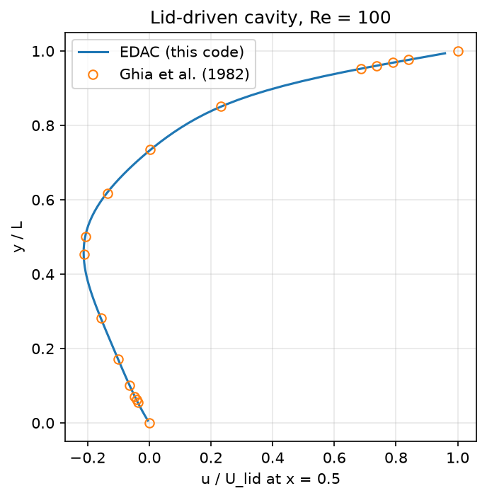
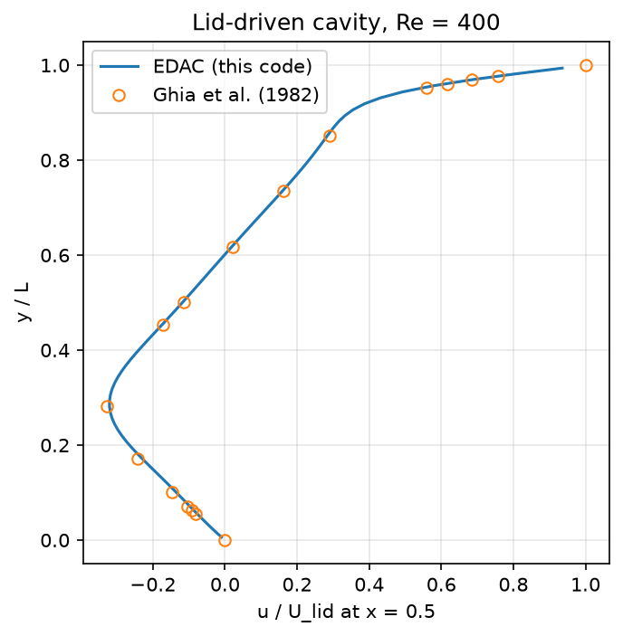
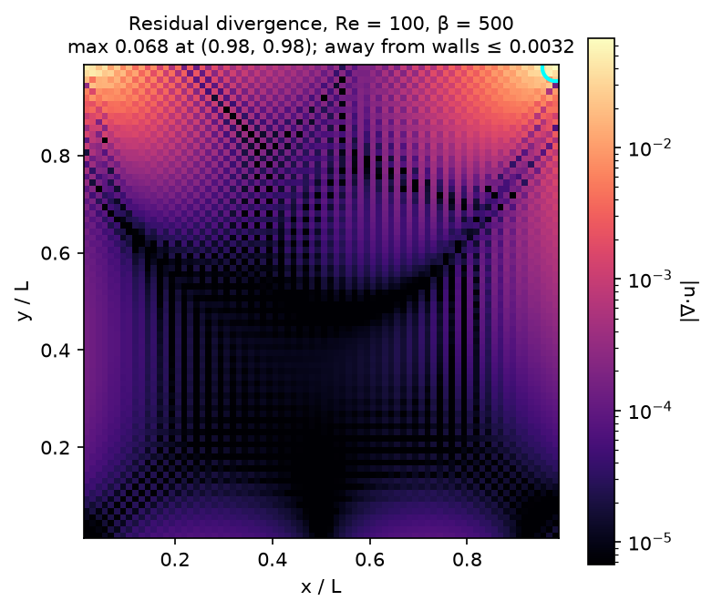
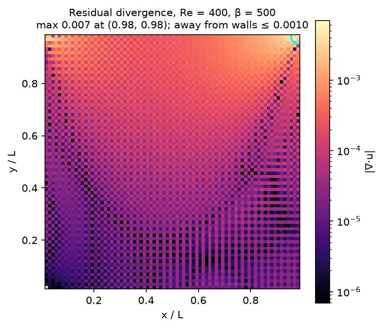
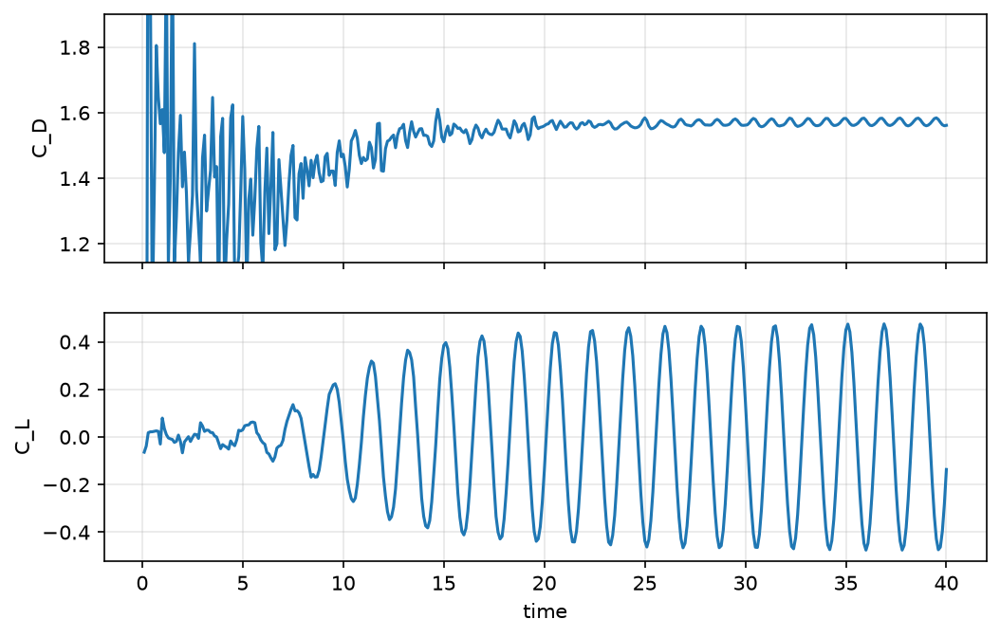

# ibflow — 2-D Immersed Boundary Flow Solver

[](https://github.com/krishna24558/ibflow/actions/workflows/tests.yml)

A compact 2-D incompressible-flow solver written in Python and accelerated with Numba. It combines

- an **Entropically Damped Artificial Compressibility (EDAC)** formulation on a **collocated finite-volume grid** (non-uniform Cartesian, ghost-cell boundaries),
- a **direct-forcing immersed boundary method (IBM)** with a cosine regularised delta kernel, so bodies of any shape can sit on a simple Cartesian mesh,
- **2nd-order TVD Runge–Kutta** time integration.

Cases included: lid-driven cavity, developing channel flow, flow past a circular cylinder and flow past a NACA 0012 airfoil.

## Validation: lid-driven cavity

horizontal velocity along the vertical centerline, x/L = 0.5, on an 80 × 80 physical grid (82 × 82 including ghost cells). Compared with Ghia, Ghia & Shin (1982), 80 × 80 grid (`make validate`):

| Re = 100 | Re = 400 |
|:---:|:---:|
|  |  |

| Re | max \|u − u<sub>Ghia</sub>\| | RMS error | min u (this code / Ghia) |
|---:|---:|---:|---:|
| 100 | 0.0044 | 0.0020 | −0.2130 / −0.2109 |
| 400 | 0.0128 | 0.0062 | −0.3204 / −0.3273 |

### Residual divergence

The exact incompressible solution satisfies ∇·u = 0. In this implementation,
the EDAC pressure update includes pressure diffusion. When the pressure
update is near steady state, the balance is approximately
∇·u = (ν/β)∇²p, so the numerical velocity field can retain residual
divergence at finite β.

The logged maximum excludes the ghost cells and the outermost layer of
physical cells. In both cavity runs, the reported peak was near the
top-right lid corner, at (x/L, y/L) ≈ (0.981, 0.981).

| Re | Final maximum absolute divergence | Maximum away from walls |
|---:|---:|---:|
| 100 | 0.0675 | 0.0032 |
| 400 | 0.0069 | 0.0010 |

| Absolute divergence, Re = 100 | Absolute divergence, Re = 400 |
|:---:|:---:|
|  |  |


## Governing equations

With pressure *p*, velocity **u**, density ρ, viscosity ν and artificial-compressibility parameter β:

```
∂p/∂t + β ∇·u          = ν ∇²p          (EDAC pressure evolution)
∂u/∂t + ∇·(u u) + ∇p/ρ = ν ∇²u + f_IBM   (momentum)
```

The ν∇²p term damps the pressure (acoustic) waves that artificial compressibility introduces, so no pressure-Poisson solve is needed and every step is explicit and local. β sets the artificial sound speed √β and so trades the remaining ∇·u error against the stable time step.

**Immersed boundary.** The body is a set of Lagrangian markers. At each marker the fluid velocity is interpolated with a 4-point cosine delta, the forcing `f = −u_marker/Δt` (no-slip, stationary body) is computed, and it is spread back onto the grid with the same kernel. The hydrodynamic force on the body is the negative sum of that forcing.

## Repository layout

```
ibflow/
  solver.py       EDAC right-hand side, face interpolation, divergence
  ibm.py          IBM forcing (interpolate → force → spread) and body force
  boundary.py     cavity, channel, free-stream and convective-outlet ghost cells
  integrators.py  TVD RK2 steps (plain, with IBM, with IBM + convective outlet)
  geometry.py     grids, circle and NACA 4-digit marker generation
  runner.py       time loop, logging, progressive .npz saving
cases/            lid_cavity.py, channel.py, external_body.py (cylinder / naca0012)
validation/       Ghia et al. (1982) centreline data
tests/            fast sanity tests (pytest)
notebooks/        the original exploratory notebook (outputs stripped)
plot.py           post-processing: divergence maps, centreline, profile, field, Cd/Cl history,     
Makefile
```

## Quick start

```bash
git clone https://github.com/<your-username>/ibflow.git
cd ibflow
make install        # numpy, numba, matplotlib, pytest
make test           # seconds
make quick          # short run of every case to check the pipeline
make validate       # cavity Re=100 and 400 vs Ghia (~8 min on the machine used for these runs)
```

Full runs (each saves `results/<case>.npz` and PNGs):

```bash
make cavity                 # Re=400, original 180x180 stretched grid
make cylinder               # Re=100
make airfoil                # NACA 0012, Re=100
make cylinder STEPS=50000   # shorter run
make cavity RE=100          # different Reynolds number
```

Every case script also takes command-line options (`python cases/external_body.py --help`). Runs save progressively, so stopping with Ctrl-C still leaves usable data.

## Cylinder at Re = 100: vortex shedding

A small off-center vertical velocity perturbation (`--perturb 0.1`)
breaks the initial wake symmetry. The run used Δt = 4 × 10⁻⁴ and
100,000 time steps.



| Quantity | ibflow result | Published 2-D results |
|---|---:|---:|
| Strouhal number | 0.165 | 0.164–0.165 |
| Lift coefficient amplitude | 0.475 | 0.332–0.339 |
| Mean drag coefficient | 1.555 | 1.33–1.35 |

The shedding frequency agrees with the published results, while the lift
amplitude and mean drag are higher. Grid resolution, immersed-boundary
force spreading, and confinement are possible contributors. This run
does not isolate their effects.

The earlier run gave a drag coefficient near 1.3 but did not show
sustained lift oscillations. That value was not a mean over developed
shedding cycles.

## Roadmap

- [ ] Trigger vortex shedding (perturbed inflow), report Strouhal number and C<sub>L</sub> amplitude
- [ ] Grid-convergence study for the cylinder drag
- [ ] Angle of attack for the airfoil and lift curve
- [ ] Moving bodies (IBM with prescribed motion)
- [ ] Energy equation (heat transfer from immersed bodies)

## References

- U. Ghia, K. N. Ghia, C. T. Shin, "High-Re solutions for incompressible flow using the Navier–Stokes equations and a multigrid method", *J. Comput. Phys.* 48 (1982) 387–411.
- J. R. Clausen, "Entropically damped form of artificial compressibility for explicit simulation of incompressible flow", *Phys. Rev. E* 87 (2013) 013309.
- C. S. Peskin, "The immersed boundary method", *Acta Numerica* 11 (2002) 479–517.

## License

MIT, see [LICENSE](LICENSE).
